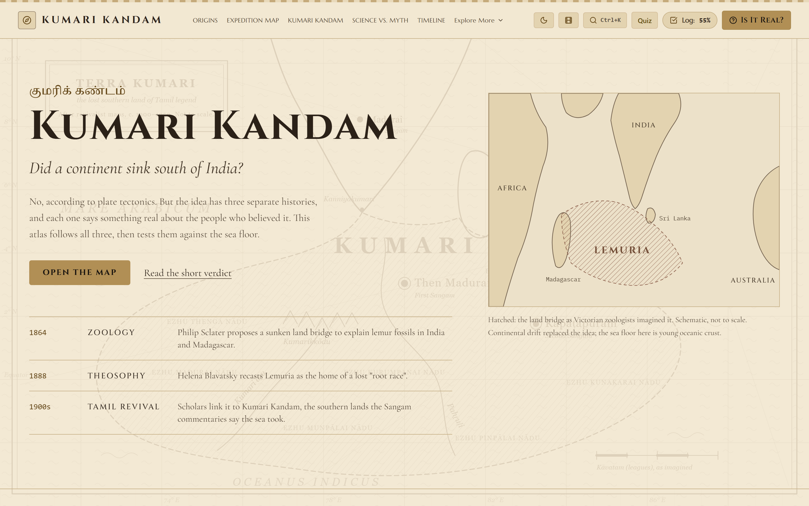
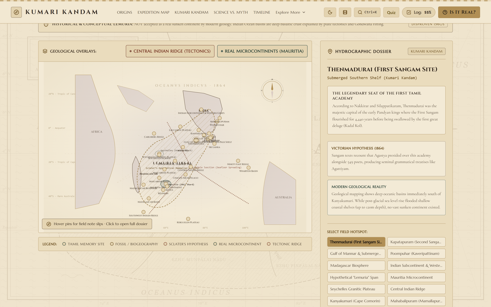
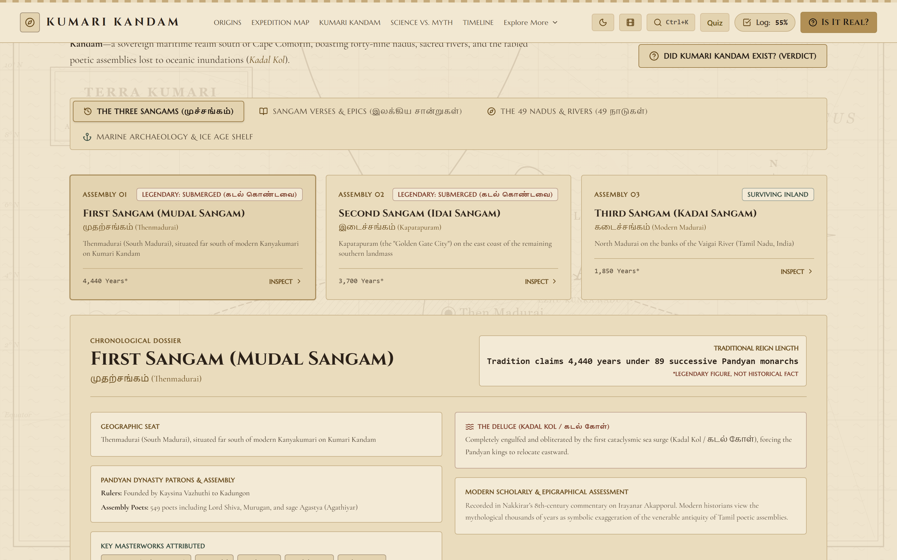
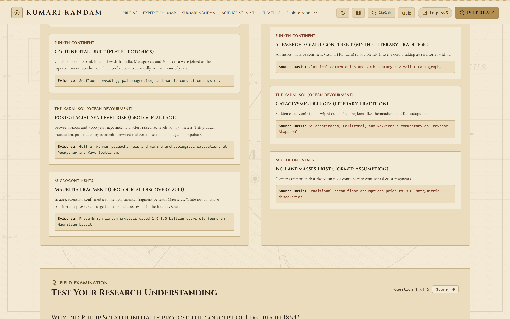
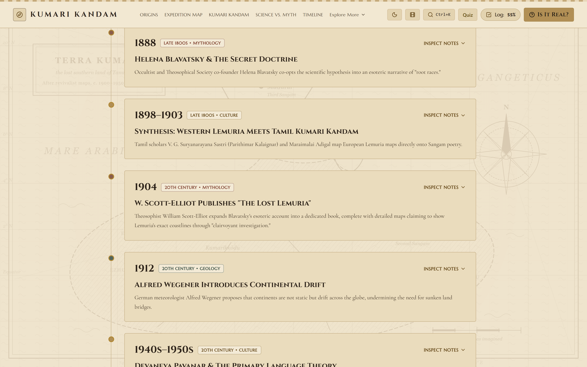
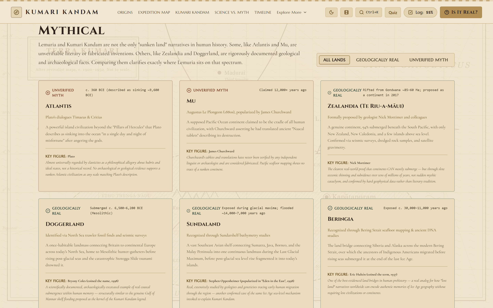
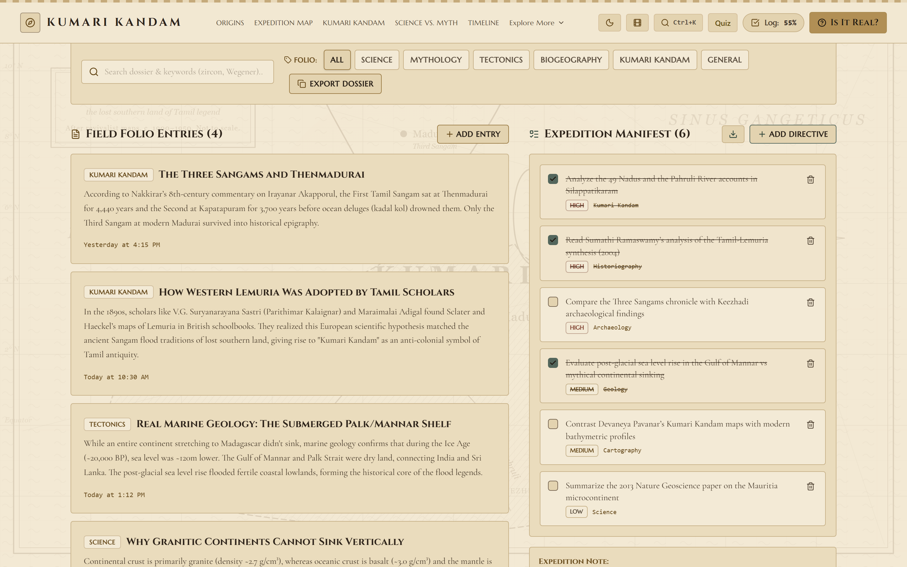
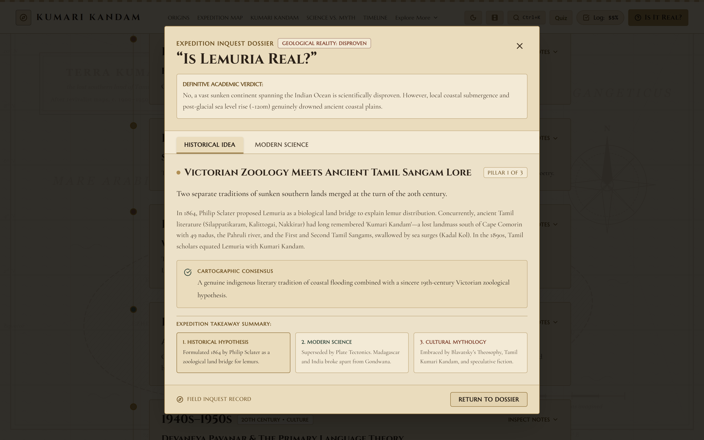

<div align="center">

# 📜 Lemuria & Kumari Kandam: Lost Continent Explorer

### *An Interactive Research Platform, Map Exploration Toolkit, & Educational Suite Dissecting Ancient Myth and Modern Oceanography*

[](https://react.dev)
[](https://www.typescriptlang.org/)
[](https://vitejs.dev/)
[](https://tailwindcss.com/)
[](https://motion.dev/)
[](https://opensource.org/licenses/MIT)

[Live Demo](https://kumarikandam-the-lost-mythology.vercel.app/) • [Visual Tour](#-visual-tour--screenshots) • [Key Features](#-key-features) • [Tech Stack](#-tech-stack) • [Quickstart](#-quickstart--installation) • [Science vs. Myth](#-science-vs-myth-matrix) • [Architecture](#-project-architecture)

---



</div>

## 📖 Overview

Before the theory of plate tectonics was verified in the 1960s, 19th-century zoologists hypothesized **Lemuria**—a lost landmass bridging India and Madagascar—to explain shared fossilized lemur fauna across distant shores of the Indian Ocean. Decades later, Tamil cultural revivalists identified Lemuria with **Kumari Kandam** (குமரிக் கண்டம்), the legendary sunken continent described in classical Tamil Sangam literature (*Silappatikaram*, *Kapaadapuram*).

**Lemuria & Kumari Kandam Explorer** is an ultra-modern web application wrapped in an **ancient parchment visual aesthetic**. It provides interactive historical map exploration, comparative scientific matrices, educational quizzes, chronological timelines, and a local research productivity suite to analyze the confluence of folklore, Tamil literature, and marine geology.

> [!NOTE]
> **Scientific Verdict**: Modern oceanography proves that while large land bridges never sank overnight, microcontinents such as **Mauritia** *did* submerge during the breakup of Gondwana, and sea-level rise post-LGM inundated historical coastal settlements like Poompuhar.

---

## 📸 Visual Tour & Screenshots

Explore the key interfaces and interactive modules included in the platform:

| Module | Preview | Description |
| :--- | :--- | :--- |
| **Hero & Navigation** |  | Parchment-styled hero landing with 3-strand historical synopsis and real-time research progress tracking. |
| **Interactive Map Explorer** |  | Multi-layered Indian Ocean cartographic explorer with tectonic plates, soundings, and geological hotspots. |
| **Kumari Kandam Deep Dive** |  | Sangam literature analysis, deluges (*Kadal Kol*), and Pandyan dynasty historical context. |
| **Science vs. Myth Matrix** |  | Side-by-side empirical comparison table contrasting 19th-century land bridges with plate tectonics. |
| **Chronological Timeline** |  | Historical arc tracing ideas from 1864 zoology to the modern discovery of Mauritia and Zealandia. |
| **Comparative Lost Lands** |  | Evidence spectrum analyzing Atlantis, Mu, Zealandia, Doggerland, Sundaland, and Beringia. |
| **Research Productivity Suite** |  | Client-side note taking, task checklists, reading progress tracker, and export tools. |
| **Scientific Verdict Modal** |  | Concise executive summary distilling geological facts from mythological claims. |

---

## 📑 Table of Contents

- [📖 Overview](#-overview)
- [📸 Visual Tour & Screenshots](#-visual-tour--screenshots)
- [✨ Key Features](#-key-features)
  - [1. 🗺️ Interactive Ancient Map Explorer](#1-️-interactive-ancient-map-explorer-uncharted-style)
  - [2. 🏛️ Deep Dive: Kumari Kandam in Tamil Tradition](#2-️-deep-dive-kumari-kandam-in-tamil-tradition)
  - [3. 🔬 Science vs. Myth Matrix & Interactive Quiz](#3-️-science-vs-myth-matrix--interactive-quiz)
  - [4. ⏳ Chronological Timeline (1860s–Present Day)](#4-️-chronological-timeline-1860s--present-day)
  - [5. 🌍 Comparative Gallery: Sunken & Submerged Lands](#5-️-comparative-gallery-sunken--submerged-lands)
  - [6. 📝 Integrated Research Productivity Suite](#6-️-integrated-research-productivity-suite)
  - [7. 📚 Categorized Bibliography & Sources Checklist](#7-️-categorized-bibliography--sources-checklist)
  - [8. 💻 Quick Verdict & Standout Export Modals](#8-️-quick-verdict--standout-export-modals)
- [🛠️ Tech Stack](#-tech-stack)
- [🚀 Quickstart & Installation](#-quickstart--installation)
- [📜 Available Scripts](#-available-scripts)
- [🌐 Deployment Guide](#-deployment-guide)
- [📂 Project Architecture](#-project-architecture)
- [🧪 Science vs. Myth Matrix](#-science-vs-myth-matrix)
- [🤝 Contributing](#-contributing)
- [📄 License](#-license)

---

## ✨ Key Features

### 1. 🗺️ Interactive Ancient Map Explorer (Uncharted Style)
* **Dynamic Layer Switching**: Seamlessly toggle between **19th-Century Mythological Maps**, **Modern Tectonic Plate Boundaries**, and **Submerged Microcontinents (Mauritia)**.
* **Annotated Interactive Hotspots**: Inspect geographic coordinates and research notes for key sites including the **Mascarene Plateau**, **South Kanyakumari**, **Madagascar Lemur Biogeography**, and the **Kerguelen Microcontinent**.
* **Real-Time Ocean Soundings**: Dynamic telemetry panel rendering coordinates, depth profiles, and bathymetric data upon hotspot selection.

### 2. 🏛️ Deep Dive: Kumari Kandam in Tamil Tradition
* **Sangam Literature Analysis**: In-depth exploration of the **First (Madurai)** and **Second (Kapaadapuram)** Tamil Sangams.
* **Cataclysmic Inundation Chronology**: Examination of historical coastal deluges (*Kadal Kol*) documented in classical texts such as *Silappatikaram*.
* **Revivalist Movement**: Insights into key historical figures including V.G. Suryanarayana Sastri (Parithimar Kalaignar) and the cultural framing of sunken ancestral homelands.

### 3. 🔬 Science vs. Myth Matrix & Interactive Quiz
* **Side-by-Side Empirical Comparison**: Direct comparative grid contrasting 19th-century land-bridge theories with modern bathymetry, sea-floor spreading, and continental drift.
* **Knowledge Challenge Quiz**: Self-assessment module with instant feedback, score calculation, and detailed academic rationales.

### 4. ⏳ Chronological Timeline (1860s – Present Day)
* **Historical Development Arc**: Trace the evolution from Philip Sclater (1864) and Ernst Haeckel (1870s) to W. Scott-Elliot (1904), Tamil revivalists (1900s), Alfred Wegener (1912), plate tectonics (1960s), down to the 2013 discovery of the **Mauritia microcontinent** and the 2017 formalization of **Zealandia**.

### 5. 🌍 Comparative Gallery: Sunken & Submerged Lands
* **Evidence Spectrum Grid**: Compare 6 prominent sunken land narratives—**Atlantis**, **Mu**, **Zealandia**, **Doggerland**, **Sundaland**, and **Beringia**—filtered by whether they are geologically verified landmasses or mythological fabrications.

### 6. 📝 Integrated Research Productivity Suite
* **Interactive Notebook**: Create, tag, search, filter, and export research notes.
* **Task Manager**: Organize literature reading lists, prioritize goals, and check off milestones.
* **Progress Dashboard**: Dynamic progress bar calculating completion rates based on written notes, finished tasks, and reviewed citations.
* **Persistent Storage**: Automatic client-side synchronization using browser `localStorage`.

### 7. 📚 Categorized Bibliography & Sources Checklist
* **Curated Academic Reading List**: Categorized literature tagged under **Historical**, **Geological**, and **Literary & Cultural** domains.
* **Reading Checklists**: Track your study progress by marking papers and monographs as read.

### 8. 💻 Quick Verdict & Standout Export Modals
* **"Is Lemuria Real?" Scientific Verdict Modal**: Instant executive summary distilling geological facts from mythological claims.
* **Interactive Search (Ctrl+K / Cmd+K)**: Quick modal lookup across all concepts, texts, and timeline milestones.

---

## 🛠️ Tech Stack

| Layer | Technology | Version | Purpose |
| :--- | :--- | :--- | :--- |
| **UI Framework** | [React](https://react.dev/) | `^19.0.1` | Component architecture & dynamic client-side rendering |
| **Language** | [TypeScript](https://www.typescriptlang.org/) | `~5.8.2` | Strict type safety and data models |
| **Build Tool & Server** | [Vite](https://vitejs.dev/) | `^6.2.3` | Ultra-fast HMR development server & optimized production bundling |
| **Styling** | [Tailwind CSS](https://tailwindcss.com/) | `^4.1.14` | Custom parchment theme tokens and responsive layouts |
| **Animations** | [Motion](https://motion.dev/) | `^12.23.24` | Smooth transitions, micro-interactions, and modal effects |
| **Iconography** | [Lucide React](https://lucide.dev/) | `^0.546.0` | Accessible and sleek SVG icons |
| **Analytics** | [@vercel/analytics](https://vercel.com/analytics) | `^2.0.1` | Performance & visitor Insights |

> [!TIP]
> **Zero Backend Required**: This application is entirely static and client-side. No external APIs or database setups are required to run or deploy.

---

## 🚀 Quickstart & Installation

### Prerequisites

* **Node.js**: `v18.0.0` or higher
* **Package Manager**: `npm`, `pnpm`, or `yarn`

### Installation Steps

1. **Clone the Repository**
   ```bash
   git clone https://github.com/theflighttechofficial/Kumarikandam-the-lost-mythology.git
   cd Kumarikandam-the-lost-mythology
   ```

2. **Install Dependencies**
   ```bash
   npm install
   ```

3. **Launch Development Server**
   ```bash
   npm run dev
   ```
   Open [`http://localhost:3000`](http://localhost:3000) in your browser to view the application.

---

## 📜 Available Scripts

In the project directory, you can run:

| Command | Description |
| :--- | :--- |
| `npm run dev` | Starts the local Vite development server on port `3000` with host listening enabled. |
| `npm run build` | Runs TypeScript compilation and generates the optimized static bundle in `/dist`. |
| `npm run preview` | Serves the compiled production build locally for verification. |
| `npm run lint` | Runs `tsc --noEmit` to verify type safety across all files. |
| `npm run clean` | Removes the build artifact directory (`/dist`). |

---

## 🌐 Deployment Guide

The application compiles into static HTML, CSS, and JS assets inside the `dist/` directory via `npm run build`.

### Deploying to Netlify
A pre-configured `netlify.toml` is included in the project root:
- **Build Command**: `npm run build`
- **Publish Directory**: `dist`
- Connect your GitHub repository to Netlify for automatic CI/CD deployments.

### Deploying to Vercel
A pre-configured `vercel.json` is included in the project root:
- **Build Command**: `npm run build`
- **Output Directory**: `dist`
- Import the project directly in the Vercel dashboard.

### Deploying to GitHub Pages / Static Hosting
```bash
npm run build
```
Upload the generated content inside `dist/` to any static web host, S3 bucket, or Cloudflare Pages instance.

---

## 📂 Project Architecture

```text
Kumarikandam-the-lost-mythology/
├── index.html                   # HTML entry point with custom font imports
├── package.json                 # Dependency manifests & NPM scripts
├── tsconfig.json                # TypeScript compiler configuration
├── vite.config.ts               # Vite configuration & server options
├── netlify.toml                 # Netlify deployment configuration
├── vercel.json                  # Vercel deployment configuration
├── docs/
│   └── screenshots/             # High-resolution screenshots of the atlas UI
├── public/                      # Static assets, SVG icons, and sitemaps
└── src/
    ├── main.tsx                 # React application mounting point
    ├── App.tsx                  # Root layout component & main state management
    ├── index.css                # Parchment theme CSS tokens, scrollbar styling, & animations
    ├── types.ts                 # TypeScript types (Notes, Tasks, Sources, Map Hotspots)
    ├── data/
    │   └── lemuriaData.ts       # Datasets for Quizzes, Timeline, Bibliography, & Map Hotspots
    └── components/
        ├── Navbar.tsx           # Top navigation bar with research progress meter
        ├── Hero.tsx             # Interactive parchment hero section
        ├── WhatIsLemuria.tsx    # Historical background & origins of Philip Sclater's hypothesis
        ├── InteractiveMap.tsx   # Cartography explorer with interactive hotspots & soundings
        ├── KumariKandamSection.tsx # Tamil Sangam literature & cultural research module
        ├── ScienceVsMyth.tsx    # Empirical comparison matrix & interactive quiz module
        ├── TimelineSection.tsx  # Chronological timeline from 1864 to modern oceanography
        ├── RelatedLostLands.tsx # Comparative gallery of 6 real and mythical sunken lands
        ├── ProductivitySuite.tsx# Research notebook, task checklist, & progress stats tracker
        ├── SourcesSection.tsx   # Academic bibliography & reading status toggles
        ├── Footer.tsx           # Academic footer with links & credits
        └── RealModal.tsx        # "Is Lemuria Real?" quick verdict popup modal
```

---

## 🧪 Science vs. Myth Matrix

| Domain | 19th Century Hypothesis / Myth | Modern Oceanographic & Geological Science |
| :--- | :--- | :--- |
| **Land Bridge Origin** | Drowned continent bridging India & Madagascar | Continental drift via **Gondwana fragmentation** (180–120 Mya) |
| **Faunal Migration** | Lemurs crossed via a continuous land bridge | Oceanic rafting / island hopping across early Indian Ocean channels |
| **Kumari Kandam** | Drowned ancient landmass south of Kanyakumari | Sea-level rise post-LGM inundated coastal cities like Poompuhar |
| **Submerged Crust** | Drowned continent beneath ocean floor | **Mauritia**: Precambrian continental fragment beneath Mauritius volcanoes |

---

## 🤝 Contributing

Contributions, issues, and feature requests are welcome!

1. **Fork** the repository
2. **Create** a feature branch (`git checkout -b feature/AmazingFeature`)
3. **Commit** your changes (`git commit -m 'Add AmazingFeature'`)
4. **Push** to the branch (`git push origin feature/AmazingFeature`)
5. **Open** a Pull Request

---

## 📄 License

Distributed under the **MIT License**. See `LICENSE` for details.

---

<div align="center">

<sub>Designed & Built with ❤️ for history, Tamil literature, marine geology, and interactive web exploration.</sub>

</div>
